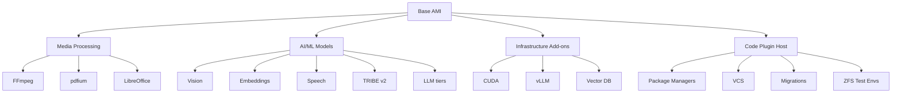

# Safebots Infrastructure

[](LICENSE)
[](CHANGELOG.md)
[](CHANGELOG.md)
[](docs/SAFEBOX-FINAL-APRIL-2026.md)
[](#composable-components)

**Trusted, Attested Safebox Infrastructure for Organizations and Businesses to Reproduce and Verify**

> **Status**: Pre-release working tree for the 1.0.0 launch. Versioning is held at 1.0.0 until first publication; subsequent changes increment 1.0.x.

---

*Production-grade cloud infrastructure specifications: hardware attestation, deterministic builds, package manager pinning, ZFS test environments, and multi-cloud support (AWS, GCP, Azure).*

> **Scope**: This repository covers the **Linux / AMI / server-runtime** layer only — OS install, ZFS setup, package management, container runtime, AI models, and the localhost API surface that the Safebox plugin uses. The Safebox plugin itself (PHP/Node code that runs the governance pipeline, capabilities, and Protocol.* primitives) lives in a separate [Safebox repo](https://github.com/Safebots/Safebox).

---

## 📋 Table of Contents

- [What's in this Repo](#whats-in-this-repo)
- [Quick Start](#quick-start)
- [Architecture](#architecture)
  - [Composable Components](#composable-components)
  - [System Protocol — Interface to Safebox Plugin](#system-protocol--interface-to-safebox-plugin)
  - [LLM Tiers](#llm-tiers)
  - [Storage Architecture (ZFS + Docker + MariaDB)](#storage-architecture-zfs--docker--mariadb)
  - [Deterministic Inference](#deterministic-inference)
- [Features](#features)
  - [Package Manager Version Pinning](#package-manager-version-pinning)
  - [ZFS Test Environment Cloning](#zfs-test-environment-cloning)
  - [Image Manifest Contract](#image-manifest-contract)
- [Build System](#build-system)
- [Security](#security)
  - [Threat model](#threat-model)
  - [What's defended](#whats-defended)
  - [What's pending before we'd claim "audited"](#whats-pending-before-wed-claim-audited)
- [License Compliance](#license-compliance)
- [Documentation](#documentation)
- [Contributing](#contributing)
- [Roadmap](#roadmap)
- [Support](#support)

---

## What's in this Repo

This repo builds attested AWS AMIs (with planned GCP/Azure images) that ship the **Linux-level runtime** the Safebox plugin runs on. It is intentionally a thin layer:

**What we provide:**

- A locked OS configuration — pinned versions, encrypted ZFS, hardened Docker, hardened PHP-FPM
- 20 composable components, opt in to only what you need
- 70+ AI models in 5 size tiers (tiny to XL), all on permissive licenses
- The **`system` component** — a localhost-only API at `127.0.0.1:7780` exposing package management, VCS, migrations, and ZFS test-environment cloning, which the Safebox plugin's Code feature calls
- Cascading manifest attestation — every component's SHA256 contributes to a single cascade hash sealed in TPM PCRs
- Reproducible builds — anyone can rebuild from source and verify the cascade matches

**What we do NOT provide:**

- The Safebox plugin (governance, capabilities, sandboxed code execution) — that's a Qbix PHP/Node plugin in [its own repo](https://github.com/Safebots/Safebox)
- The Crypto plugin (Q.Sandbox, OpenClaim signing, Merkle/Bloom data structures) — that's in [its own repo](https://github.com/Safebots/Crypto)
- The frontend (Groups app, Intercoin, etc.) — separate again

This separation matters. A bug in the Safebox plugin (e.g. a governance bypass, a Protocol.HTTP misuse) doesn't require an AMI rebuild — it's a plugin code change. A bug in the Infrastructure layer (e.g. a missing telnetd removal, a Docker daemon misconfiguration) does. Keeping the boundary clear keeps both sides auditable.

### Key Features

- 🔐 **Hardware Attestation** — TPM 2.0 measured boot with verifiable build chain
- 🔄 **Reproducible Builds** — Pinned packages, lockfile-verified npm, deterministic AMI hash
- 📦 **Package Manager Pinning** — SHA256-verified npm, composer, pip, cargo, and 11 more
- 🧪 **ZFS Test Environments** — Instant CoW clones for safe code execution
- 📋 **Image Manifest Contract** — Typed envVars, outputFiles, exitCodes per code-runner image
- ☁️ **Multi-Cloud Ready** — AWS (current), GCP & Azure (planned)
- 🧩 **20 Composable Components** — Base + 19 optional modules
- 🤖 **70+ AI Models** — Tiny (1.5B) to XL (744B parameters)
- 🔒 **Triple Encryption** — Nitro RAM + vTPM + ZFS AES-256-GCM
- 🎯 **Deterministic Inference** — Reproducible AI without breaking crypto
- ✅ **GPL-Free Runtime** — 100% permissive licenses
- 💾 **ZFS Storage** — Instant snapshots, clones, encrypted datasets
- 🗄️ **Native MariaDB** — File-per-table with ZFS dataset isolation

### Component Sizing

| Component | Description | Size |
|-----------|-------------|------|
| **base** (required) | MariaDB, PHP-FPM, nginx, Docker, Node.js, ZFS, hardened defaults | ~8 GB |
| **media** | FFmpeg (LGPL), pdfium, libvips, ImageMagick | ~370 MB |
| **vision** | SigLIP, BiRefNet, SAM 2 | ~1.5 GB |
| **embed** | BGE-M3, Nomic, Jina | ~1.5 GB |
| **speech** | Whisper Turbo/Large, Silero VAD, Kokoro TTS | ~1.2 GB |
| **tribe** | Brain-aligned neuroscore for context selection | ~400 MB |
| **system** | Localhost API for Safebox Code plugin (package mgrs, VCS, migrations, test envs) | ~50 MB |
| **llm-** tiers | Tiny (7.5 GB) to XL (850 GB) | Variable |

**Total:** 15 GB (tiny config) to 850 GB (XL config) depending on selection

---

## Quick Start

### 1. Clone Repository

```bash
git clone https://github.com/Safebots/Infrastructure
cd Infrastructure/aws
```

### 2. Provision the ZFS pool (one-time per host)

The base installer expects `safebox-pool` to exist. Create it on a dedicated EBS volume:

```bash
zpool create -o ashift=12 -O compression=lz4 -O atime=off \
    safebox-pool /dev/nvme1n1
```

See [docs/STORAGE-SETUP.md](docs/STORAGE-SETUP.md) for full pool-creation guidance.

### 3. Generate the attested ZFS key

```bash
sudo ./scripts/generate-attested-key.sh
# Creates /run/safebox/zfs-key sealed to TPM PCRs
```

### 4. Choose a Configuration

**Development / Edge:**
```bash
sudo ./scripts/build-ami.sh base,llm-tiny
# Result: 15 GB, 8 GB RAM, t3.large
```

**Production (Recommended):**
```bash
sudo ./scripts/build-ami.sh base,media,vision,embed,speech,tribe,llm-medium
# Result: 110 GB, 64 GB RAM, r6i.8xlarge
```

**Code Plugin Host:**
```bash
sudo ./scripts/build-ami.sh base,media,system,llm-medium
# Result: 115 GB, 64 GB RAM, r6i.8xlarge
# Adds: package managers, VCS, migrations, ZFS test environments
```

**Research / Frontier:**
```bash
sudo ./scripts/build-ami.sh base,media,vision,embed,speech,tribe,system,llm-xl,cuda,vllm
# Result: 850 GB, 256+640 GB RAM, p5.48xlarge
```

### 5. Deploy to AWS

```bash
aws ec2 run-instances \
  --image-id ami-xxxxx \
  --instance-type r6i.8xlarge \
  --key-name your-key \
  --metadata-options "HttpTokens=required,InstanceMetadataTags=enabled"

# Verify TPM attestation (matches the cascade manifest)
./scripts/verify-attestation.sh <instance-id>
```

### 6. Run Deterministic Inference

```bash
export SAFEBOX_INFERENCE_SEED="my_research_seed_12345"
export LD_PRELOAD=/opt/safebox/lib/libsafebox_deterministic.so
echo "Explain quantum computing" | llama-cli --model qwen-3.6-27b-q4.gguf
# Same seed + same input = byte-identical output across runs
```

---

## Architecture

### Composable Components

Safebox uses a **modular component system**. Select only what you need:



**Full component list:**

| # | Component | Size | Description |
|---|-----------|------|-------------|
| 1 | `base` | ~8 GB | OS, MariaDB, PHP, nginx, Docker, Node.js, ZFS *(required)* |
| 2 | `media` | ~370 MB | FFmpeg, pdfium, libvips, ImageMagick |
| 3 | `libreoffice` | ~600 MB | Office document conversion |
| 4 | `vision` | ~1.5 GB | SigLIP, BiRefNet, SAM 2 |
| 5 | `vision-hq` | ~3 GB | High-quality vision models |
| 6 | `embed` | ~1.5 GB | BGE-M3, Nomic, Jina embeddings + rerankers |
| 7 | `speech` | ~1.2 GB | Whisper Turbo/Large v3, Silero VAD, Kokoro TTS |
| 8 | `speech-hq` | ~2 GB | Whisper Large v3, high-quality TTS |
| 9 | `ocr` | ~50 MB | PaddleOCR |
| 10 | `llm-tiny` | ~7.5 GB | Gemma E2B, Qwen 4B, Phi-mini, Privacy Filter |
| 11 | `llm-small` | ~26 GB | Qwen 8B, Mistral 12B, Phi-4, Gemma 9B |
| 12 | `llm-medium` | ~103 GB | Qwen 27B, Gemma 4 31B/26B, Mistral 24B *(recommended)* |
| 13 | `llm-large` | ~169 GB | Llama Scout, Qwen 72B, Llama 70B, Nemotron 49B |
| 14 | `llm-xl` | ~420 GB | GLM-5.1, DeepSeek V3.2, Qwen 397B |
| 15 | `cuda` | ~3 GB | NVIDIA GPU support |
| 16 | `vllm` | ~3 GB | Batched LLM serving |
| 17 | `diffusion-small` | ~8 GB | Stable Diffusion *(AGPL — flagged)* |
| 18 | `index` | ~300 MB | FalkorDB vector/graph *(SSPL — flagged)* |
| 19 | `tribe` | ~400 MB | TRIBE v2 brain-aligned neuroscore |
| 20 | `system` | ~50 MB | Localhost API for Safebox Code plugin |

### System Protocol — Interface to Safebox Plugin

The `system` component exposes Infrastructure-level operations to the Safebox plugin over **localhost only**. This is the boundary between the two repos: the Safebox plugin (PHP/Node) calls these endpoints to perform privileged operations that the AMI layer owns.

**Wire Protocol** (loopback `127.0.0.1:7780`):

```json
{
    "auth":      "<256-bit token from /srv/safebox/runtimes/system/auth.token>",
    "user":      "system" | "test",
    "subsystem": "package" | "vcs" | "migrate" | "test" | "image",
    "action":    "install" | "createEnv" | "...",
    "params":    { ... }
}
```

**Two privilege tiers:**

| User | Operations | Rate Limit | Governance |
|------|-----------|------------|------------|
| `system` | package, vcs, migrate | 10/min burst, 100/hr sustained | Safebox plugin enforces M-of-N before calling |
| `test` | createEnv, keepalive, destroyEnv, listEnvs | 100/min burst, 1000/hr sustained | Access-control only |

System is a superset of test — `user='system'` can invoke test operations, but `user='test'` cannot invoke system operations. Attempts return 403.

**Test Environment Lifecycle (Pattern A — one operation per container):**

```
1. createEnv(image, testId)
   └─> ZFS clone production dataset → /srv/encrypted/apps/{testId}/
   └─> docker run <image> with /app/data/ writable, user=nobody, network=none
       └─> entrypoint runs operation (cargo check, npm test, pytest, etc.)
       └─> writes /app/data/<output>.json
       └─> exits

2. (Optional) keepalive(testId)  # Extends TTL if op > 60s
   └─> Default TTL: 60s, max: 1hr, +60s per keepalive

3. destroyEnv(testId)
   └─> Infrastructure mounts clone read-only as root
   └─> Reads files declared in image's manifest.outputFiles (16 MB cap)
   └─> zfs destroy the clone
   └─> Returns telemetry to Safebox
```

**Resource limits (v1.0):**
- 10 active environments per user (hard limit)
- 50 active environments system-wide (hard limit)
- 10 GB per environment (ZFS quota)
- 16 MB telemetry per environment

Full protocol reference, manifest schema, and integration examples are in [docs/SYSTEM-PROTOCOL.md](docs/SYSTEM-PROTOCOL.md).

### LLM Tiers

#### llm-tiny (~7.5 GB)
- Gemma 4 E2B 2.3B (Apache 2.0) — Edge, mobile
- Qwen 3.6 4B (Apache 2.0) — Classification
- Phi-4-mini 3.8B (MIT) — Small tasks
- OpenAI Privacy Filter 1.5B (Apache 2.0) — PII redaction

#### llm-small (~26 GB)
- Qwen 3.6 8B (Apache 2.0)
- Mistral Nemo 12B (Apache 2.0)
- Phi-4 14B (MIT)
- Gemma 4 9B (Gemma Terms)

#### llm-medium (~103 GB) ⭐ **RECOMMENDED**
- Qwen 3.6 27B (Apache 2.0) — Coding, 77.2% SWE-bench Verified
- Gemma 4 31B Dense (Apache 2.0) — 89.2% AIME 2026
- Gemma 4 26B MoE (Apache 2.0) — 3.8B active
- Qwen 3.6 35B-A3B (Apache 2.0) — MoE, 3B active
- Mistral Small 4 24B (Apache 2.0) — Multimodal
- Qwen 3.6 32B (Apache 2.0)

#### llm-large (~169 GB)
- Llama 4 Scout 109B MoE (Llama Community) — 17B active, 10M context
- Qwen 3.6 72B (Qwen License)
- Llama 3.3 70B (Llama Community)
- Nemotron Super 49B (NVIDIA Open)

#### llm-xl (~420–860 GB)
- GLM-5.1 744B MoE (MIT) — #1 SWE-bench Pro
- DeepSeek V3.2 685B MoE (MIT) — 32B active
- Qwen 3.5 397B (Apache 2.0)
- Llama 4 Maverick 400B MoE (Llama Community)

### Storage Architecture (ZFS + Docker + MariaDB)

```
/ (ext4, root volume)
├── /boot                           # ext4 (AWS boot requirement)
├── /var/log                        # ext4 (system logs)
└── /srv (ZFS pool: safebox-pool)   # All data on ZFS
    │
    ├── /srv/safebox                # Binaries, models (ZFS dataset, 20G quota)
    │   ├── bin/, lib/, runtimes/, models/
    │   ├── runtimes/system/        # System component
    │   │   ├── auth.token          # 256-bit shared secret
    │   │   └── package-versions/   # SHA256 manifests
    │   └── manifests/              # Component manifests
    │
    ├── /srv/docker                 # Docker storage (ZFS dataset, 100G quota)
    │   └── ...                     # Native ZFS storage driver
    │
    ├── /srv/encrypted              # Encrypted tenant data
    │   ├── apps/                   # Per-app ZFS datasets (production)
    │   ├── cache/                  # Tenant package caches (planned)
    │   └── logs/                   # System component append-only logs
    │
    ├── /srv/mariadb                # MariaDB datadir (ZFS dataset)
    │   ├── data/                   # System tables
    │   ├── tenants/                # Per-tenant ZFS sub-datasets, quota+encryption
    │   └── projects/
    │
    └── /srv/zfs-clones             # Ephemeral test clones (destroyed on destroyEnv)
```

All datasets use `encryption=aes-256-gcm` with the key at `/run/safebox/zfs-key` (TPM-sealed, released only on matching PCRs).

### Deterministic Inference

```bash
export SAFEBOX_INFERENCE_SEED="seed_string"
export LD_PRELOAD=/opt/safebox/lib/libsafebox_deterministic.so

# AI-only RNG via LD_PRELOAD. Crypto operations still use /dev/urandom.
# Only inference RNG paths are deterministic.
```

See [docs/DETERMINISTIC-AI-ONLY-RNG.md](docs/DETERMINISTIC-AI-ONLY-RNG.md).

---

## Features

### Package Manager Version Pinning

**The threat**: Supply chain attacks compromise legitimate package managers, then attack downstream. The May 2025 TanStack/"Mini Shai-Hulud" campaign compromised 42 official npm packages, spreading to OpenSearch, Mistral AI, Guardrails AI, UiPath, and Squawk packages. The malware hooked into developer-environment configs (.claude/settings.json, .vscode/tasks.json) via lifecycle scripts.

**Two defenses at the Infrastructure layer:**

1. **Pinned binaries with SHA256 verification.** Every package manager binary — npm, composer, pip, cargo, etc. — is verified against a checked-in SHA256 manifest before execution. A compromised binary doesn't match its hash; execution is refused.

2. **`npm ci --ignore-scripts` for the base npm install.** The base installer never runs `npm install <packages>` (which would fetch latest versions). Instead it runs `npm ci` against a checked-in `package-lock.json` with integrity hashes for every tarball, and `--ignore-scripts` blocks lifecycle scripts (the TanStack attack vector).

**Supported package managers (all pinned):**

| Language | Managers |
|----------|----------|
| JavaScript | npm, yarn, pnpm |
| PHP | composer |
| Python | pip, pipenv, poetry |
| Ruby | gem, bundle |
| Rust | cargo |
| Go | go (toolchain) |
| Java | mvn, gradle |
| System | dnf, apt, apk |

If a binary's SHA256 doesn't match the pinned manifest, the installer refuses to execute it. See [docs/PACKAGE-MANAGER-PINNING.md](docs/PACKAGE-MANAGER-PINNING.md).

### ZFS Test Environment Cloning

Production app data on `/srv/encrypted/apps/{appName}/mysql/` is cloned via ZFS CoW. Tests can INSERT/UPDATE/DELETE in isolation. `zfs destroy` removes all changes instantly.

```
createEnv → ZFS clone production
         → docker run <image>
            → entrypoint runs operation
            → writes /app/data/<output>.json
            → exits
         → Safebox calls destroyEnv
         → Infrastructure reads manifest.outputFiles
         → zfs destroy clone
         → return telemetry
```

**Container isolation:**
- Run as `nobody` (UID 5000+)
- `network=none` only
- Can only write to `/app/data/`
- Output limited to files declared in image manifest

See [docs/ZFS-TEST-ENVIRONMENTS.md](docs/ZFS-TEST-ENVIRONMENTS.md).

### Image Manifest Contract

Every code-runner image declares its contract at `/app/manifest.json`:

```json
{
    "name":       "code-runner:rust-1.85-build",
    "operation":  "build",
    "language":   "rust",
    "version":    "1.85",
    "entrypoint": "/app/run-build.sh",
    "envVars": {
        "CARGO_PROFILE": {
            "required": false,
            "default":  "dev",
            "values":   ["dev", "release"],
            "doc":      "Cargo build profile"
        }
    },
    "outputFiles": [
        {
            "path":     "/app/data/build-output.json",
            "format":   "cargo-message-format-json",
            "required": true
        }
    ],
    "exitCodes": {
        "0":   "build succeeded",
        "1":   "build failed",
        "101": "cargo internal error",
        "124": "timeout"
    },
    "resourceHints": {
        "memoryMb":    2048,
        "cpus":        2,
        "timeoutMs":   180000,
        "diskWriteMb": 500
    }
}
```

Manifest is inside the image. Tampering changes the image hash → signature mismatch → image refused.

---

## Build System

```bash
./scripts/build-ami.sh <component-list>

# Examples:
./scripts/build-ami.sh base,llm-tiny                          # Minimal
./scripts/build-ami.sh base,media,vision,embed,llm-medium     # Production
./scripts/build-ami.sh base,system,llm-medium                 # Code plugin host
./scripts/build-ami.sh base,media,vision,embed,speech,tribe,system,llm-xl,cuda,vllm  # Frontier
```

Each component installer is at `scripts/components/<name>/install-<name>.sh`. Components are independent; ordering is automatic.

Every build runs:
1. Pre-flight check (required components present, ZFS pool exists, key file present)
2. Component install in declared order
3. Manifest generation per component
4. Cascade SHA256 over all manifests
5. TPM attestation seal
6. Package manager binary checksum verification

---

## Security

> **Pre-release honesty**: Safebox 1.0 is a pre-release. The defenses below are real and meaningful — zero interactive shell access alone puts an attested Safebox instance ahead of probably 95% of cloud deployments. But the Safebox stack has not yet undergone third-party security audit, is not yet running on Confidential Computing instance types by default, and has not yet been pen-tested. We do not claim "truly secure" — we claim "production-grade, third-party audit in progress."

The base installer (`install-base.sh`) hardens the AMI at the Linux/AMI layer. The Safebox plugin layer has its own security model on top (governance, sandboxing, capability isolation) documented in the [Safebox repo](https://github.com/Safebots/Safebox).

### Threat model

Safebox is designed to defend against a specific set of threats. Knowing what's in scope and what's out of scope matters more than any individual hardening measure.

**In scope — Safebox defends against these:**

| Threat | Defense |
|--------|---------|
| Stolen SSH keys reaching the instance | SSH removed entirely from production AMIs |
| Stolen AWS IAM credentials used to start an interactive session | `amazon-ssm-agent` removed; `aws ssm start-session` cannot reach the instance |
| Stolen package registry credentials pushing malicious updates | `npm ci --ignore-scripts` with SHA-512 integrity verification from a locked manifest |
| Compromised package binary (e.g., trojan-horse npm package manager) | Package manager binaries verified against SHA256 manifest before execution |
| Modified boot artifacts (kernel, initrd, rootfs) | TPM-sealed ZFS keys released only on matching PCR values |
| Container escape into host privilege | Docker `userns-remap=default`, `no-new-privileges=true`, `icc=false` |
| SQL injection or web-shell uploads escalating to subprocess execution | PHP `disable_functions` blocks `exec`, `shell_exec`, `system`, etc. at the language level |
| Memory exfiltration via remote network shell | No remote shell mechanism exists to exfiltrate from |
| Server-side request forgery into cloud metadata or private networks | Safebox plugin Protocol.HTTP SSRF protection (16+ encoded-IP forms blocked, DNS rebinding blocked) |
| Cross-organization data writes via the action queue | Cross-org check on `payload.publisherId`, `toPublisherId`, `fromPublisherId` at every write site |
| Tampering with running instance going undetected | Auditd rules on ZFS key access, package manager invocations, config writes, setuid escalation; append-only audit logs cryptographically chained |
| Side-loaded code modifying production data | Test environments isolated via ZFS clones; production datasets never mutated by test runs |
| Test-environment exfiltration via undeclared output paths | Manifest-declared `outputFiles` are the only data returned from test containers; everything else discarded with the ZFS clone |

**Out of scope — Safebox does NOT defend against these (at least not yet):**

| Threat | Why it's out of scope |
|--------|----------------------|
| The cloud provider reading your RAM | Standard EC2 trusts AWS at the hypervisor level. Confidential Computing instance types (AMD SEV-SNP, Intel TDX) defend against this; Safebox 1.0 does not require them. Planned for post-1.0. |
| Side-channel attacks (Spectre, Rowhammer, AES-NI timing) | Mitigations exist at the OS/microcode level (we apply them) but new variants emerge; no system can claim immunity. |
| AI model weight poisoning at the source | We checksum the model tarballs, but the checksums come from the same source as the models. Independent signature verification is a post-1.0 item. |
| vTPM rollback attacks | AWS vTPM is software-emulated; the guarantee is only as strong as Amazon's implementation. We do not currently defend against published vTPM rollback techniques. |
| Time-of-check vs time-of-use kernel vulnerabilities | Attestation happens at boot. A kernel CVE discovered after boot doesn't trigger re-attestation. Mitigation is short-lived instances (rotate every N hours), which is operationally costly. |
| Insider attacks by AWS personnel | Outside our threat model. If you cannot trust AWS, you cannot run on AWS — that's a fundamental property of any cloud deployment. |
| Physical attacks on AWS data centers | Outside our threat model. AWS physical security is what it is. |
| Forensic-environment compromise | When a terminated instance is snapshotted for offline analysis, the forensic environment needs the ZFS key. That environment's security is a separate problem we don't yet solve cleanly. |
| Zero-days in the Safebox plugin itself | We've fixed 130 documented bugs during pre-release development. We've found 4 more in the most recent audit pass. There are almost certainly more. Bug bounty planned post-1.0. |
| Compromised LLM provider returning malicious tool code | The Safebox plugin's capability sandbox is the line of defense here, not the AMI. Sandbox bugs (we've found 17 historically) reduce its effectiveness. |

If any "out of scope" item is critical for your use case, Safebox 1.0 is not the right fit for that use case yet. Talk to us about your requirements before deploying.

### What's defended

#### Hardware & boot
- Deterministic AI inference without breaking cryptographic randomness
- Per-dataset ZFS encryption (AES-256-GCM)
- TPM-sealed keys, released only on matching PCR values
- vTPM 2.0 measured boot
- Nitro Enclave hardware RAM encryption (AWS, optional)

#### Zero interactive shell access
The attested Safebox model rests on the guarantee that the running code is exactly the code that booted. Any interactive shell — SSH, AWS SSM Session Manager, EC2 Serial Console login — defeats that guarantee, because once a human has a shell they can read the ZFS key from `/run/`, `kexec` a new kernel, or modify a running binary in memory. The base installer therefore removes `openssh-server`, `amazon-ssm-agent`, and all TTY/serial-console getty units.

What you keep: outbound HTTPS for AWS API access via IAM-role instance metadata (S3, KMS, CloudWatch, etc.), normal application traffic on configured ports. What you lose: any way to log into the box. Diagnostics happen against an offline ZFS snapshot of a terminated instance, not on a live shell. See [docs/SECURITY-HARDENING.md](docs/SECURITY-HARDENING.md) for the full policy and operational implications.

#### Runtime isolation
- Docker daemon with `userns-remap=default` — containers run as host UID 100000+
- Docker `no-new-privileges=true`, `icc=false`
- PHP-FPM with `expose_php=Off`, dangerous functions disabled (`exec`, `shell_exec`, `system`, `proc_open`, `popen`, etc.)
- nginx with hardened defaults (configured per-component)
- systemd-based resource isolation with cgroups
- chroot filesystem isolation per tenant
- auditd rules for ZFS key access, package manager invocations, config file writes, setuid escalation attempts

#### Supply chain
- All system packages pinned to specific versions with post-install verification
- All base npm packages installed via `npm ci --ignore-scripts` from lockfile with SHA-512 integrity hashes
- Image manifest signing — manifest hash is part of image hash
- CVE-2026-32746 mitigation — telnetd explicitly removed, verified at end of install
- Reproducible builds — same input produces same cascade SHA256

#### Test environment isolation (system component)
- Test containers run as `nobody` (UID 5000+)
- Cannot access production secrets
- `network=none` only (namespace registry planned post-1.0)
- Can only write to `/app/data/`
- Output limited to files declared in image manifest (16 MB cap)

### What's pending before we'd claim "audited"

These are the items between current state and a defensible "third-party audited" claim. They're tracked on the post-1.0 roadmap; none of them are blockers for developer preview.

- **Third-party security audit.** [docs/AUDIT.md](aws/docs/AUDIT.md) is the comprehensive checklist auditors should work through — 278 specific checks across six phases (trust root, base component, system component, cross-component verification, two-AMI diff verification, out-of-band review). The audit happens on AMI-A (with SSH for auditor access); after sign-off, AMI-B is built from the same source with `--remove-ssh` and is byte-identical to AMI-A except for the documented removals. Clients pin to AMI-B's cascade hash.
- **Confidential Computing instance types.** Move the attested production profile from regular EC2 to AMD SEV-SNP or Intel TDX so AWS hypervisor cannot read guest RAM.
- **Independent reproducible-build verification.** Right now we ship the cascade SHA256 and trust ourselves. The right model is for someone else to build from source and verify they get the same hash. Planning a public attestation registry for this.
- **External penetration test.** Different from code audit — tests a deployed instance against runtime, network, and AWS configuration attacks.
- **Audit of all 20 component installers.** I audited `install-base.sh`. The other 19 component installers haven't been reviewed at the same depth yet.
- **Deeper Safebox plugin audit.** Q.Sandbox, Crypto, and the credential-derivation pipeline need their own focused passes.
- **Bug bounty program.** Once public, paying attackers to find what we missed is the most cost-effective security investment available.

### Audit history (Infrastructure layer)

This pre-release audit pass identified 10 Linux/AMI-level issues in `install-base.sh` — missing directory creation, ZFS encryption misconfiguration, unpinned npm installs, missing remote-shell removal (telnet, SSH, SSM agent, console getty), Docker daemon defaults, PHP-FPM exposure, and others. All are fixed in the current `install-base.sh` with eight verification gates that abort the build if any of them survive. See [docs/SECURITY-HARDENING.md](docs/SECURITY-HARDENING.md) and [CHANGELOG.md](CHANGELOG.md) for details.

### Reporting vulnerabilities

Pre-release security issues: greg@qbix.com. Once we launch a public bug bounty, that channel will be the preferred route — but for now, direct email is the right path.

---

## License Compliance

100% permissive licenses in the runtime path. AGPL and SSPL components (diffusion-small, index) are excluded by default and clearly flagged when opted in.

**Runtime licenses:**
- Apache 2.0 — MariaDB, PHP, Node.js, ZFS-on-Linux, BGE-M3, Qwen 3.6, Gemma 4
- MIT — Phi-4, GLM-5.1, DeepSeek V3.2
- LGPL — FFmpeg (dynamically linked, runtime-only)
- BSD — nginx, Docker engine

---

## Documentation

### Core
- [README.md](README.md) — This file
- [CHANGELOG.md](CHANGELOG.md) — Pre-release development log
- [CONTRIBUTING.md](CONTRIBUTING.md) — Contribution guide
- [docs/QUICKSTART.md](docs/QUICKSTART.md) — Getting started
- [docs/ARCHITECTURE.md](docs/ARCHITECTURE.md) — System architecture

### Security
- [docs/SECURITY-HARDENING.md](docs/SECURITY-HARDENING.md) — Base AMI hardening details
- [docs/AUDIT.md](docs/AUDIT.md) — Pre-deployment audit checklist (278 checks across 6 phases for third-party auditors)
- [docs/AMI-SECURITY-SUMMARY.md](docs/AMI-SECURITY-SUMMARY.md) — Higher-level overview
- [docs/CASCADING-MANIFESTS.md](docs/CASCADING-MANIFESTS.md) — Attestation cascade

### Components
- [docs/PACKAGE-MANAGER-PINNING.md](docs/PACKAGE-MANAGER-PINNING.md) — Pinning system
- [docs/ZFS-TEST-ENVIRONMENTS.md](docs/ZFS-TEST-ENVIRONMENTS.md) — Test environment cloning
- [docs/SYSTEM-PROTOCOL.md](docs/SYSTEM-PROTOCOL.md) — Localhost API reference (the boundary to the Safebox plugin)
- [docs/STORAGE-SETUP.md](docs/STORAGE-SETUP.md) — ZFS pool provisioning

### Models
- [docs/SAFEBOX-COMPLETE-SUMMARY.md](docs/SAFEBOX-COMPLETE-SUMMARY.md)
- [docs/SAFEBOX-FINAL-APRIL-2026.md](docs/SAFEBOX-FINAL-APRIL-2026.md) — April 2026 model lineup
- [docs/AI-ML-STACK-COMPLETE.md](docs/AI-ML-STACK-COMPLETE.md)
- [docs/DETERMINISTIC-AI-ONLY-RNG.md](docs/DETERMINISTIC-AI-ONLY-RNG.md)

---

## Contributing

See [CONTRIBUTING.md](CONTRIBUTING.md). Pull requests welcome on:
- New component installers
- Model integrations
- Cloud provider implementations (GCP, Azure)
- Documentation improvements
- Security audit follow-ups

---

## Roadmap

### Pre-release polish (current)
- Continue Linux/AMI security audit
- GCP and Azure parity with AWS
- Documentation expansion
- Load testing with multi-tenant workloads

### Post-1.0 features

**Phase A (Infrastructure additions):**
- Cache mounts for test environments (per-workspace, tenant-language-version)
- Network namespaces with M-of-N-signed registry — for integration tests against staging
- Multi-arch images (ARM64)
- Operator-configurable per-tenant resource caps
- HMAC + timestamp on the wire protocol (for remote executors, not just localhost)

**Phase B (model and platform expansion):**
- Llama 4 Scout integration (10M context)
- Real-time streaming inference
- Multi-modal unified embeddings
- Cross-lingual video search
- Edge optimization (Q3_K_M quantization)
- Kubernetes deployment support
- Network mode `bridge` (advanced)

---

## Support

- **Documentation**: [docs/](docs/)
- **Issues**: GitHub Issues
- **Discussion**: https://community.safebots.ai
- **Pre-release support**: greg@qbix.com
- **Safebox plugin repo**: https://github.com/Safebots/Safebox (separate codebase)
